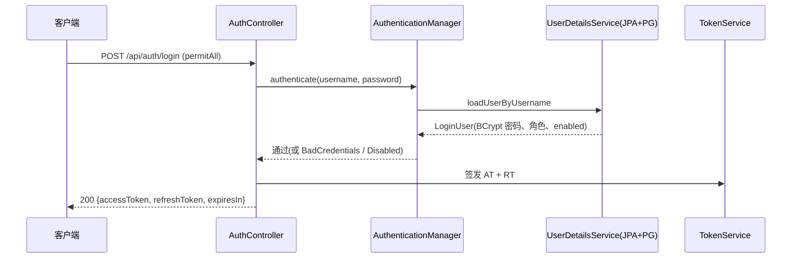
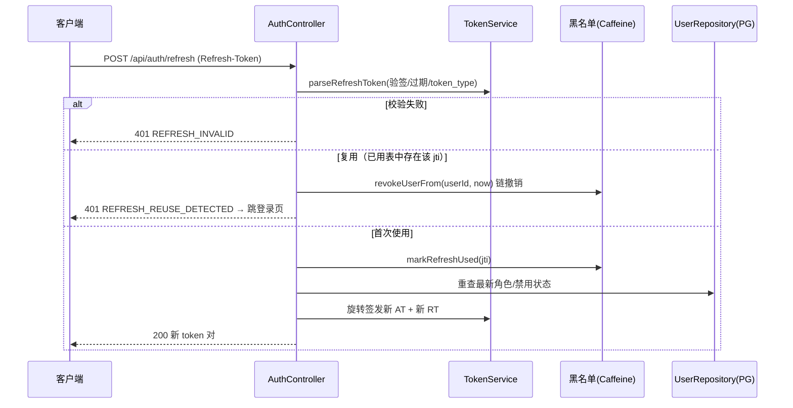

# Spring Boot 模块 JWT 认证方案（PRD 总纲）

> 状态：**✅ 已确认（2026-11-16 评审通过，按 M1→M5 实施）** · v2.0（2026-11-17 瘦身重组）
> 文档地图：**[README.md](README.md)** —— 本文只回答 **Why 与范围**；实现细节在三份专题文档：
> Token 层 → [jwt.md](jwt.md) · 认证授权层 → [spring-security.md](spring-security.md) · 数据层 → [jpa.md](jpa.md)

---

## 目录

1. [背景与目标](#1-背景与目标)
2. [总体架构与技术选型](#2-总体架构与技术选型)
3. [Token 设计摘要](#3-token-设计摘要)
4. [认证与授权流程](#4-认证与授权流程)
5. [异常场景契约](#5-异常场景契约)
6. [包结构总览](#6-包结构总览)
7. [配置总览](#7-配置总览)
8. [API 契约](#8-api-契约)
9. [安全性考量](#9-安全性考量)
10. [测试计划](#10-测试计划)
11. [实施步骤](#11-实施步骤)
12. [决策记录（已确认）](#12-决策记录已确认)

---

## 1. 背景与目标

`spring-boot` 模块目前只有 Web、Validation 等基础演示代码，没有任何认证能力。本方案为该模块补齐一套**标准的 JWT 认证体系**，作为后续演示和扩展的基座。

| # | 目标 | 说明 |
|---|------|------|
| G1 | 标准 JWT 双令牌机制 | Access（短效）+ Refresh（长效），均通过 **HTTP Header** 传输 |
| G2 | 全局接入 Spring Security | 认证逻辑挂在 Security 过滤器链上，对**所有**请求统一生效，业务代码零侵入 |
| G3 | 全局可获取用户与权限 | 任意层级（Controller / Service / 异步线程等）都能拿到当前登录用户和权限 |
| G4 | 无状态（Stateless） | 不使用 HttpSession，水平扩展不需要 Session 共享 |
| G5 | 统一的 401/403 JSON 响应 | 认证失败、权限不足返回结构一致的 JSON + 错误码 |
| G6 | 服务端真失效 | 登出即失效 + Refresh 复用检测（盗用撤销整条链），基于 **Caffeine 本地缓存**；未来引入 Redis 无缝切换（接口已预留） |

**非目标（本期不做）**：OAuth2 授权服务器 / 第三方登录 / SSO；多租户；细粒度数据权限；**Redis 本期不引入**（黑名单先 Caffeine，多实例部署时切换）。

---

## 2. 总体架构与技术选型

| 项目 | 选择 | 版本 | 说明 |
|------|------|------|------|
| 安全框架 | Spring Security | 随 Boot 4.1.3 → 7.0.x | SecurityFilterChain + Lambda DSL |
| JWT 库 | **jjwt**（api/impl/jackson） | 0.11.5 | ✅ 决策 Q1 |
| 签名算法 | **HS256**，密钥 ≥ 256 bit | — | ✅ 决策 Q5 |
| 黑名单缓存 | **Caffeine**（本期）/ Redis（未来） | 随 Boot 管理 | ✅ 决策 Q3 |
| 用户存储 | **JPA + PostgreSQL** | 随 Boot 管理 | ✅ 决策 Q4（本期引入数据库） |
| 测试数据库 | H2（PG 兼容模式，test scope） | 随 Boot 管理 | [jpa.md §6](jpa.md#6-测试h2-替身) |
| 密码存储 | BCrypt | — | Spring Security 事实标准 |
| 会话策略 | STATELESS | — | 不创建/使用 HttpSession |

```
客户端                        spring-boot 模块
──────                        ─────────────────────────────────────────────
                              ┌──────────────── SecurityFilterChain ──────┐
 POST /api/auth/login         │                                            │
 {username, password}  ─────▶ │  AuthController → AuthenticationManager    │
                              │        → DaoAuthenticationProvider         │
 ◀──── accessToken +          │        → UserDetailsService(JPA + PG)      │
       refreshToken           │        → BCrypt 校验 → TokenService 签发   │
                              │                                            │
 GET /api/xxx                 │  ┌─ JwtAuthenticationFilter                │
 Authorization: Bearer <at> ─▶│  │  1. 解析 Bearer token（验签/过期/类型）  │
                              │  │  2. 黑名单检查 jti + 用户级链撤销         │──▶ Caffeine
                              │  │  3. 构造 Authentication(含权限)           │
                              │  │  4. 写入 SecurityContextHolder            │
                              │  └─▶ 业务 Controller（@PreAuthorize 可用） │
                              │                                            │
 POST /api/auth/refresh       │  AuthController → TokenService             │
 Refresh-Token: <rt>    ─────▶│  验 type=refresh → 复用检测 → 签发新 token │──▶ Caffeine
 ◀──── 新 accessToken(+rt)    │                                            │
                              │        ↕ JPA                               │
                              │  PostgreSQL（users / user_roles 表）       │
                              └────────────────────────────────────────────┘
```

核心思想：**JwtAuthenticationFilter 是全局认证入口**（"翻译官"），把请求头里的 JWT 翻译成标准 `Authentication` 放进 `SecurityContextHolder`；此后授权判定、`@PreAuthorize`、全局取用户全是 Spring Security 原生能力，业务代码零侵入。

---

## 3. Token 设计摘要

> 机制详解（claims 表、签名密钥、签发/解析代码、旋转/复用检测/黑名单三张表）→ **[jwt.md](jwt.md)**

| | Access Token | Refresh Token |
|---|---|---|
| 用途 | 访问业务接口 | 仅换新令牌 |
| 有效期 | **30 分钟**（`jwt.access-token-ttl`） | **7 天**（`jwt.refresh-token-ttl`） |
| 传输 | `Authorization: Bearer <accessToken>` | `Refresh-Token: <refreshToken>`（自定义头） |
| 携带 roles | ✅（签发时刻快照） | ❌（刷新时从 PG 重载最新角色） |

刷新策略（✅ 决策 Q2）：**旋转 + 复用检测 + 链撤销** —— 每次刷新双双换新；RT 单次使用；旧 RT 再现 = 盗用信号 → 用户级链撤销。机制见 [jwt.md §3](jwt.md#3-生命周期刷新撤销与黑名单)。

---

## 4. 认证与授权流程

### 4.1 登录



### 4.2 访问受保护接口

`JwtAuthenticationFilter`（挂在用户名密码 Filter 之前）：取 Bearer → 验签/验期/验 `token_type=access` → 黑名单 + 链撤销检查（[jwt.md §3](jwt.md#3-生命周期刷新撤销与黑名单)）→ 构造 Authentication 写入 SecurityContext → 授权规则/`@PreAuthorize` 判定 → Controller。
**设计原则**：Filter 只翻译不拦截；失败静默降级，错误码经 request attribute 传给 EntryPoint 统一出口。全链路实现 → [spring-security.md §3–4](spring-security.md#3-本项目过滤器链设计)。

### 4.3 刷新



### 4.4 登出（服务端真失效）

客户端携 `Authorization`（AT）+ `Refresh-Token`（RT）调 `POST /api/auth/logout` → 两个 `jti` 写入 Caffeine 黑名单（TTL = 各自剩余寿命）+ RT 登记已用 → 旧 AT `401 TOKEN_REVOKED`、旧 RT `401 REFRESH_INVALID`，**即刻生效**。机制与调用链 → [jwt.md §3.4](jwt.md#34-登出调用链)。

---

## 5. 异常场景契约

> 错误的产生与转换逻辑 → [spring-security.md](spring-security.md)；对外格式以此表为准。

| 场景 | HTTP | `error` | 触发点 |
|---|:---:|---|---|
| 未携带 token 访问受保护接口 | 401 | `UNAUTHORIZED` | EntryPoint |
| Access Token 过期 | 401 | `TOKEN_EXPIRED` | Filter → EntryPoint |
| 签名不合法 / 格式错误 | 401 | `TOKEN_INVALID` | Filter → EntryPoint |
| 用 Refresh Token 访问业务接口 | 401 | `TOKEN_TYPE_MISMATCH` | Filter（token_type 校验） |
| 已登出 / 被链撤销的 token | 401 | `TOKEN_REVOKED` | Filter（黑名单检查） |
| 用户名/密码错误 | 401 | `BAD_CREDENTIALS` | AuthController |
| 账号已禁用 | 401 | `USER_DISABLED` | AuthController（DisabledException） |
| Refresh Token 无效/过期/类型错 | 401 | `REFRESH_INVALID` | AuthController |
| Refresh Token 复用（盗用信号） | 401 | `REFRESH_REUSE_DETECTED` | AuthController → 链撤销 |
| 已认证但权限不足 | 403 | `ACCESS_DENIED` | AccessDeniedHandler |

统一响应体：`{ "code": 401, "error": "TOKEN_EXPIRED", "message": "...", "path": "/api/xxx", "timestamp": "..." }`

---

## 6. 包结构总览

新增代码收敛在 `com.esmile.auth`，与既有 `event`、`validation` 包并列；主类追加 `@ConfigurationPropertiesScan`。

```
com.esmile.auth/
├── AuthController.java                   # PRD §8 四接口
├── config/    SecurityConfig · JwtProperties
├── controller/dto/  LoginRequest · TokenResponse · UserInfo
├── filter/    JwtAuthenticationFilter    # spring-security.md §4
├── handler/   RestAuthenticationEntryPoint · RestAccessDeniedHandler   # spring-security.md §8
├── model/     LoginUser · AppRole        # jpa.md §3（映射来源）
├── service/   AuthService · TokenService(jwt.md §2)
│             TokenBlacklistService · CaffeineTokenBlacklist(jwt.md §3)
├── user/      UserEntity · UserRepository · DatabaseUserDetailsService · DataInitializer(jpa.md §1–4)
└── support/   AuthContext(spring-security.md §7) · ApiError · AuthErrorAttributes
```

**分层原则**：只有 `TokenService` 直接依赖 jjwt；黑名单只经 `TokenBlacklistService` 接口；用户只经 `UserDetailsService`/`UserRepository`——替换任何底层实现只动对应一个类。

---

## 7. 配置总览

```yaml
spring:
  datasource:
    url: jdbc:postgresql://${PG_HOST:localhost}:5432/${PG_DB:springboot_in_action}
    username: ${PG_USER:postgres}
    password: ${PG_PASSWORD:postgres}
  jpa:
    hibernate:
      ddl-auto: update          # 教学演示；生产 Flyway（jpa.md §6.1）
    open-in-view: false

jwt:
  secret: ${JWT_SECRET:ZGV2LW9ubHktc2VjcmV0LWtleS1tdXN0LWJlLTI1Ni1iaXRzLWxvbmch}
  issuer: springboot-in-action
  access-token-ttl: 30m
  refresh-token-ttl: 7d
```

字段详解：datasource / ddl-auto / OSIV → [jpa.md §5](jpa.md#5-配置详解)；secret 校验与密钥管理 → [jwt.md §2.2](jwt.md#22-密钥管理)。

---

## 8. API 契约

### 8.1 登录 `POST /api/auth/login`（permitAll）

请求 `{ "username": "admin", "password": "123456" }` →
成功 200 `{ "accessToken": "…", "refreshToken": "…", "tokenType": "Bearer", "expiresIn": 1800 }`；
失败 401：`BAD_CREDENTIALS` / `USER_DISABLED`。

### 8.2 刷新 `POST /api/auth/refresh`（permitAll）

请求头 `Refresh-Token: <refreshToken>`（无请求体）→
成功 200：同 8.1 结构（两个 token 均新签发）；失败 401：`REFRESH_INVALID` / `REFRESH_REUSE_DETECTED`（前端跳登录页）。

### 8.3 当前用户 `GET /api/auth/me`（需认证）

请求头 `Authorization: Bearer <at>` → 200 `{ "userId": "1002", "username": "admin", "roles": ["ROLE_ADMIN"] }`

### 8.4 登出 `POST /api/auth/logout`（需认证）

请求头同时携带 `Authorization`（AT）+ `Refresh-Token`（RT）→ `204 No Content`；此后旧 AT → `TOKEN_REVOKED`、旧 RT → `REFRESH_INVALID`。

### 8.5 权限演示 `GET /api/admin/dashboard`（`@PreAuthorize("hasRole('ADMIN')")`）

`ROLE_USER` → 403 `ACCESS_DENIED`；`ROLE_ADMIN` → 200。

---

## 9. 安全性考量

| # | 风险 | 措施 |
|---|---|---|
| S1 | 密钥泄露 | 环境变量注入；不入 Git；≥256bit 启动校验 |
| S2 | 算法混淆 | 解析显式限定 HS256，不读 token 自带 alg |
| S3 | 两类 token 冒用 | `token_type` claim 双向强校验 |
| S4 | 无限续期 | Access 短效 + 刷新时从 PG 重载最新角色 |
| S5 | 敏感信息泄露 | claims 仅放 userId/username/roles（JWT 不加密） |
| S6 | CSRF | Header 传 token、无 Cookie 会话 → 关闭（STATELESS 标准做法） |
| S7 | 传输窃听 | 生产强制 HTTPS |
| S8 | 时钟偏移 | 60 秒 clock skew |
| S9 | 暴力破解登录 | 本期不处理；生产网关限流 + 失败锁定 |
| S10 | 登出残留 | ✅ 已解决：jti 黑名单登出即失效；RT 复用触发链撤销 |
| S11 | 多实例黑名单不共享 | Caffeine 单机缓存；接口已预留，多实例时切 Redis |

---

## 10. 测试计划（15 条 · MockMvc + spring-security-test）

测试库用 H2（PG 兼容模式）替换 PG（[jpa.md §6](jpa.md#6-测试h2-替身)）；过期 token 构造不 sleep（TTL 配负值或反射）。

| # | 用例 | 期望 | # | 用例 | 期望 |
|---|---|---|---|---|---|
| T1 | 正确账密登录 | 200 · 双 token · expiresIn=1800 | T9 | 用 Access Token 调 refresh | 401 · REFRESH_INVALID |
| T2 | 错误密码登录 | 401 · BAD_CREDENTIALS | T10 | 有效 RT 刷新 | 200 · 新 token 可用且不同 |
| T3 | 禁用账号登录 | 401 · USER_DISABLED | T11 | 已用 RT 再次刷新 | 401 · REFRESH_REUSE_DETECTED；其新旧 token 全部 401 |
| T4 | 无 token 访问 /me | 401 · UNAUTHORIZED | T12 | logout 后旧 AT / 旧 RT | 401 · TOKEN_REVOKED / REFRESH_INVALID |
| T5 | 有效 AT 访问 /me | 200 · 用户角色正确 | T13 | ROLE_USER 访问 admin 接口 | 403 · ACCESS_DENIED |
| T6 | 篡改签名 token | 401 · TOKEN_INVALID | T14 | ROLE_ADMIN 访问同一接口 | 200 |
| T7 | 过期 Access Token | 401 · TOKEN_EXPIRED | T15 | Service 层 AuthContext 取值 | 与登录用户一致 |
| T8 | 用 RT 调业务接口 | 401 · TOKEN_TYPE_MISMATCH | | 黑名单淘汰行为 | CaffeineTokenBlacklist 单测覆盖 |

---

## 11. 实施步骤

| 里程碑 | 内容 | 验证方式 |
|---|---|---|
| M1 依赖与配置 | security / jjwt / caffeine / data-jpa / postgresql / h2(test) 依赖；JwtProperties + datasource | 启动连上 PG，配置绑定成功 |
| M2 用户体系 | UserEntity / UserRepository / DatabaseUserDetailsService / 种子 | 登录链路查 PG 用户并 BCrypt 校验 |
| M3 Token 与黑名单 | TokenService + CaffeineTokenBlacklist（黑名单/已用表/链撤销） | 单测：往返一致、异常映射、按剩余寿命淘汰 |
| M4 安全链路与接口 | SecurityConfig / Filter(含黑名单) / 401·403 Handler / AuthController | curl 全链路：登录→访问→刷新→登出→旧 token 全灭 |
| M5 全局权限与测试 | AuthContext / @PreAuthorize 演示 / 异步上下文传递 | T1–T15 全绿 |

---

## 12. 决策记录（已确认 · 2026-11-16）

| # | 决策点 | 结论 | 备注 |
|---|---|---|---|
| Q1 | JWT 库 | **jjwt 0.11.5** | 生成/解析透明，适合教学仓库 |
| Q2 | 刷新策略 | **旋转 + 复用检测 + 链撤销** | Caffeine 支撑，完整方案 |
| Q3 | 登出黑名单 | **本期就做，Caffeine 本地缓存** | 未来引入 Redis，接口已预留 |
| Q4 | 用户数据源 | **JPA + PostgreSQL（本期引入）** | 种子账号 admin/user；测试 H2 替身 |
| Q5 | 签名算法 | **HS256** | 密钥 ≥256bit，环境变量注入 |
| Q6 | 错误码风格 | 大写字符串枚举 | 按推荐执行 |
| Q7 | Refresh 头名 | `Refresh-Token` | 按推荐执行 |

> 推翻 Q1–Q7 任一决策时，在本表补记新决策与日期（备选方案：oauth2-resource-server、RS256，评审时已否决）。
